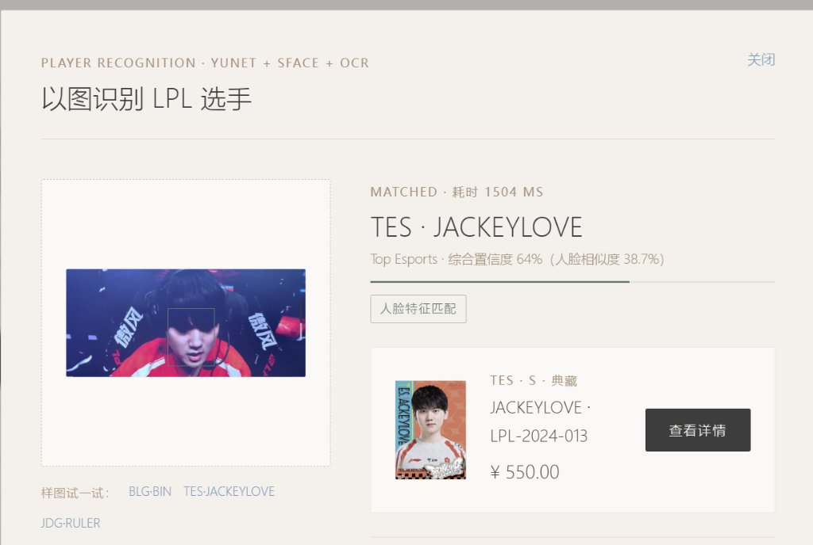
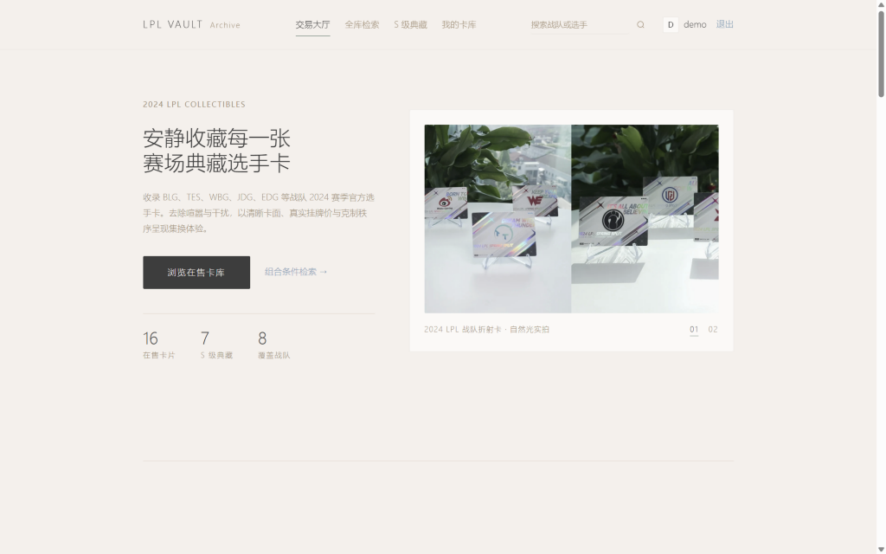
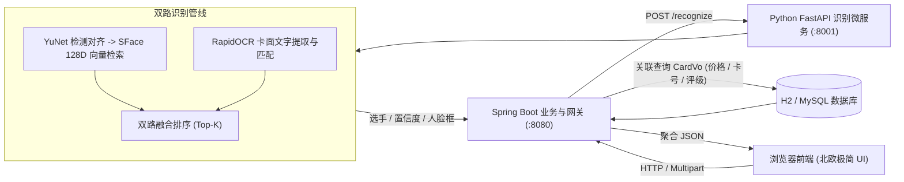

# LPL Vault · 英雄联盟职业联赛选手卡交易平台

一个面向英雄联盟职业联赛（LPL）收藏爱好者的选手卡集换与展示平台。项目采用 **Spring Boot + Python FastAPI 双服务架构**，前端采用克制安静的**北欧极简风（Hygge）**设计语言，内置**「以图识别 LPL 选手」**能力——无论是实体选手卡照片，还是赛事直播截图，都能自动识别选手并联动平台在售卡片。

---

## 功能预览

### 1. 以图识别 LPL 选手（支持赛事截图 & 实体卡面）
即使上传带有暗光、耳机、低头姿态、无任何卡面文字的**真实比赛直播截图**，系统也能通过 YuNet 人脸对齐 + SFace 128 维特征向量准确匹配到 `TES · JACKEYLOVE`，并直接拉出平台在售典藏卡与价格：



### 2. 北欧极简风交易大厅
暖灰白（`#f5f0eb`）画布、5:7 非对称留白排版、2px 微圆角、1px 沙色细边框与 700ms 缓慢过渡，提供按战队、评级（S/A/B）、价位区间与关键词的多维检索、详情下单与个人卡库管理：



---

## 核心特性

- **双路融合 AI 识人引擎（`ai-service/`）**
  - **主通路（人脸特征检索）**：采用 OpenCV Zoo **YuNet** 人脸检测与 5 点对齐 + **SFace** 128 维特征向量余弦相似度检索，跨赛季、跨卡面、支持比赛截图与单人照，**无需重训模型**即可在线扩充新选手。
  - **辅通路（卡面 OCR 增强）**：集成 **RapidOCR（ONNX）** 提取卡面战队与选手 ID 文字，对实拍卡片抗反光/抗斜拍进行融合加权，并内置防短名误匹配规则。
  - **底库持久化与在线扩库**：自动索引 `src/main/resources/static/lpl卡片/` 下的 16 张 LPL 选手卡并缓存向量；支持通过 `POST /gallery/register` 在线追加选手多角度样本或注册新选手。
- **交易大厅与个人卡库闭环**
  - 交易大厅（`home.html`）、组合检索页（`search.html`）、卡片详情与担保下单页（`detail.html`）、登录/注册页（`login.html` / `register.html`）与个人持仓/收藏/订单中心（`userInfo.html`）。
  - 全站支持点击选图、拖拽上传与 `Ctrl+V` 剪贴板粘贴直接识人。
- **零外部依赖本地快速启动**
  - 提供 `local` Spring Profile，内置 H2 文件数据库（MySQL 兼容模式），启动时通过 `LocalDataInitializer` 自动初始化 16 张 LPL 选手卡与演示账号。

---

## 系统架构



---

## 技术栈

| 层级 | 技术选型 |
|---|---|
| **后端业务与网关** | Java 8+、Spring Boot 2.6.13、Spring Data JPA、Spring Session JDBC、H2 / MySQL |
| **图像识别微服务** | Python 3.10+、FastAPI、Uvicorn、OpenCV（`FaceDetectorYN` YuNet + `FaceRecognizerSF` SFace）、RapidOCR、ONNX Runtime |
| **前端界面** | 原生 HTML5 / CSS3（Nordic Minimalist Design Tokens）/ Vanilla JS（无外部重型框架或慢 CDN 依赖） |

---

## 目录结构

```text
├── ai-service/                         # Python FastAPI 图像识别微服务 (:8001)
│   ├── main.py                         # FastAPI 入口与接口定义
│   ├── model_manager.py                # YuNet / SFace 自动下载与内存加载、RapidOCR 封装
│   ├── gallery.py                      # 16 张选手卡底库向量构建、缓存与在线注册
│   ├── recognizer.py                   # 人脸向量 + OCR 双路融合推理
│   ├── test_recognition.py             # 16 张卡准确率与负样本自动化测试
│   └── requirements.txt
├── src/main/java/com/example/cardexchange/
│   ├── config/LocalDataInitializer.java # local 模式自动初始化 16 张卡与演示账号
│   ├── controller/                     # CardController / ProductController / UserController / RecognitionController
│   ├── Service/                        # CardService / ProductService / UserService / RecognitionService
│   ├── Repository/                     # Spring Data JPA Repositories
│   ├── Entity/ & Pojo/                 # 数据库实体与 CardVo / RecognitionResultVo
├── src/main/resources/
│   ├── application.properties          # 默认配置（MySQL + SMTP + AI 服务地址）
│   ├── application-local.properties    # 本地 H2 零配置启动环境
│   └── static/                         # 北欧极简前端页面、css/app.css、js/common.js 与 16 张 LPL 卡图
├── docs/images/                        # README 功能展示截图
└── Clib4J_Test_24-11-11/               # 早期 C++ JNI + OpenCV SIFT 历史实验代码（归档保留）
```

---

## 快速启动

### 1. 启动 Python FastAPI 图像识别微服务（端口 `8001`）

```bash
cd ai-service
python -m venv .venv

# Windows PowerShell 激活并安装依赖
.\.venv\Scripts\python.exe -m pip install -r requirements.txt

# 启动服务（首次启动会自动下载 YuNet / SFace ONNX 权重并构建 16 位选手特征缓存）
.\.venv\Scripts\python.exe -m uvicorn main:app --host 0.0.0.0 --port 8001
```

启动后可访问交互式 API 文档：http://localhost:8001/docs

### 2. 启动 Spring Boot 平台服务（端口 `8080`）

```bash
# 使用内置 H2 本地环境一键启动（无需额外安装 MySQL）
mvn spring-boot:run -Dspring-boot.run.profiles=local
```

> 如需连接远程 MySQL，请先在 `src/main/resources/application.properties` 中配置你自己的数据源与邮件服务凭据（建议通过环境变量注入，勿将真实密码提交到公开仓库）。

### 3. 访问平台

- **交易大厅首页**：http://localhost:8080/home.html
- **全库检索页**：http://localhost:8080/search.html
- **登录页**：http://localhost:8080/login.html （本地演示账号：`demo` / `123456`，页面支持一键填入）
- **个人中心 & 我的卡库**：http://localhost:8080/userInfo.html
- **H2 数据库控制台（local 模式）**：http://localhost:8080/h2-console

---

## 核心 API 列表

### 业务与网关接口（`:8080`）
| 方法 | 路径 | 说明 |
|---|---|---|
| `GET` | `/card/list` | 卡片列表，支持 `keyword`、`team`、`grade`、`sort` 参数 |
| `GET` | `/card/search_by_id?id={id}` | 获取单张卡片详情（含价格与持仓信息） |
| `GET` | `/card/search_by_team?team={team}` | 按战队检索卡片（忽略大小写） |
| `GET` | `/card/recomendtions` | 获取高价值推荐卡片 |
| `GET` | `/card/user/{userId}` | 查询指定用户持仓卡片 |
| `POST` | `/api/recognize` | 上传图片识别 LPL 选手并聚合商品卡片（`multipart/form-data`，字段 `file`） |
| `GET` | `/api/recognize/health` | 检查 Python AI 识别微服务在线状态与底库规模 |
| `POST` | `/users/login` / `/users/register` / `/users/sendcode` | 用户登录、邮箱验证码发送与注册 |

### AI 微服务原生接口（`:8001`）
| 方法 | 路径 | 说明 |
|---|---|---|
| `GET` | `/health` | 模型与底库健康状态 |
| `GET` | `/gallery` | 查看当前已索引选手与样本数量 |
| `POST` | `/recognize` | 图片双路识别（支持 `top_k`、`use_ocr` 参数） |
| `POST` | `/gallery/register` | 在线上传新照片为已有选手追加特征样本或注册新选手 |
| `POST` | `/gallery/rebuild` | 重新扫描卡图目录重建特征索引 |

---

## 识别准确率自测

运行 `ai-service` 内置自动化测试脚本：

```bash
.\ai-service\.venv\Scripts\python.exe ai-service\test_recognition.py
```

实测结果：
- 16 张底库卡人脸检出与索引：**16 / 16**
- 纯人脸裁切 + 旋转 6° + 亮度变化 + JPEG 压缩（关闭 OCR）Top-1：**16 / 16**
- 完整卡面倾斜 -7° + 压缩双路融合 Top-1：**16 / 16（OCR 命中 16 / 16）**
- 无关负样本拒识：**通过（不误报）**
